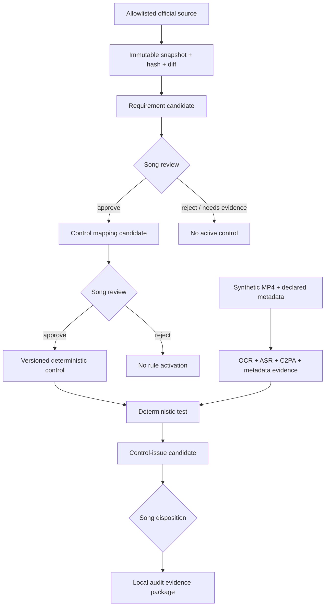
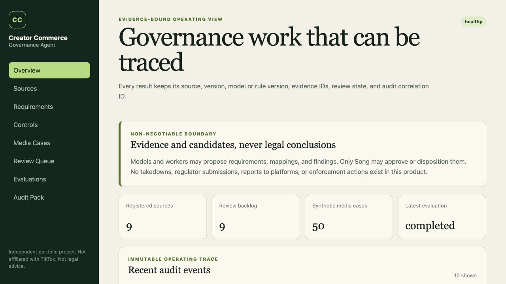
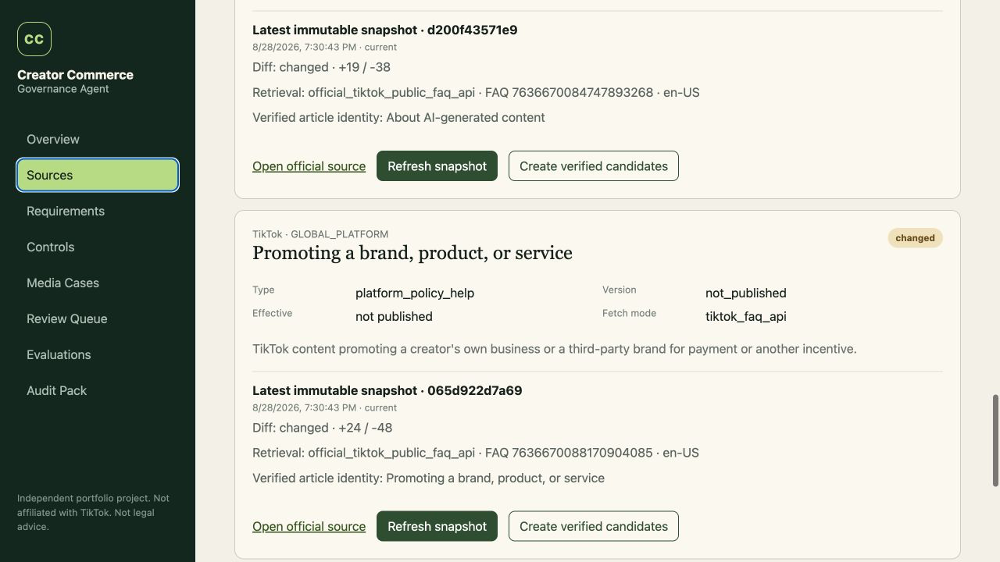
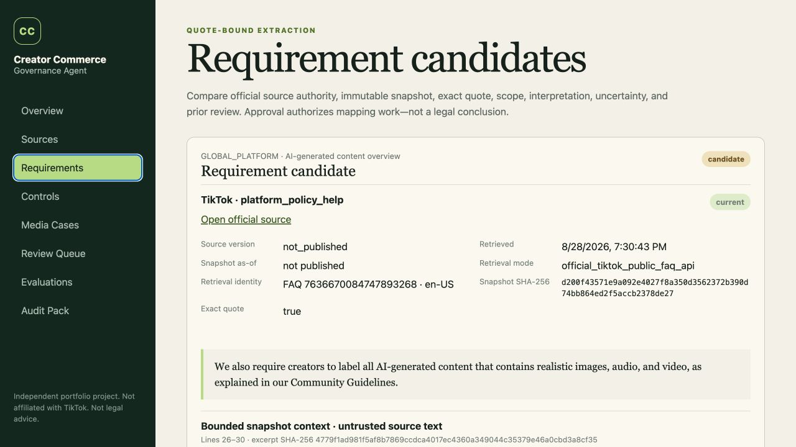

# Creator Commerce Governance Agent

An evidence-bound AI application that converts changing creator-commerce policies into reviewable requirements, maps human-approved requirements to deterministic product controls, analyzes synthetic promotional media, and produces human-reviewed governance findings and audit evidence.

> **Implementation status:** all four planned engineering phases are implemented and locally validated. The public repository contains source code, synthetic fixtures, documentation, and reproducible checks; the current local development database has nine unapproved requirement candidates (four historical fixtures and five authoritative current-source candidates across EU, FTC, and TikTok), and scheduled source monitoring is disabled. Nothing is auto-approved or silently rewritten.

This is an independent portfolio project. It is not affiliated with TikTok, the FTC, the European Commission, C2PA, or any platform or regulator. It does not provide legal advice.

## What the product demonstrates

- FastAPI, Pydantic 2, SQLAlchemy 2, Alembic, PostgreSQL 16, Redis, and Celery;
- React 19, TypeScript, Vite, responsive review workflows, and Playwright;
- allowlisted official-source monitoring, immutable snapshots, SHA-256 versioning, and diffs;
- bounded, hash-addressed source-context excerpts beside every requirement review;
- local Ollama structured extraction with exact-quote and legal-language guards;
- real synthetic MP4 generation, FFmpeg, Tesseract OCR, Faster-Whisper ASR, and C2PA inspection;
- deterministic rule activation gated by two separate human approvals;
- 50-case gold-set evaluation and a deterministic 100,000-event data pipeline;
- evidence-to-source lineage and local HTML, PDF, JSON, and CSV audit packages;
- prompt-injection boundaries, output escaping, database triggers, idempotency, audit events, and offline CI.
- fail-closed MP4 admission gates for path, declared MIME, ISO BMFF signature, size, hash, duration, resolution, frame count, and tool timeout.

## Non-negotiable boundary

The system may create a `requirement_candidate`, `mapping_candidate`, evidence bundle, deterministic test result, or `control_issue_candidate`. It may explain uncertainty and prepare a local review package.

It cannot:

- label a person, post, company, or product legal, illegal, compliant, or non-compliant;
- treat platform policy as law or regulator guidance as binding legal text;
- approve its own requirement, mapping, or finding;
- infer deception from a missing C2PA manifest;
- infer truth or legality from a valid C2PA manifest;
- take down, report, penalize, submit, message, or otherwise act externally;
- scrape authenticated pages, bypass robots, login, paywalls, CAPTCHA, or access controls;
- use real creator, merchant, user, or private platform data.

PostgreSQL triggers independently reject non-human review rows, requirement approval backed only by a public test fixture, direct requirement status changes without a matching human review, and mutation of historical source snapshots. Check constraints require meaningful non-empty rationale text for mapping candidates and all three review layers. The API and UI enforce the same boundaries before a request reaches the database.

## Workflow



One orchestration application owns the workflow. Its bounded workers cannot approve one another.

## Product evidence

The screenshots below are from the 2026-08-28 local synthetic demo. They show a point-in-time evidence state, not a live TikTok environment or a legal conclusion.







See the [public screenshot inventory](docs/SCREENSHOTS.md) for media-evidence and evaluation views, capture provenance, and limitations.

## Current official-source alignment

The registry was re-verified against primary official sources on 2026-08-28:

- FTC Endorsement Guides, FAQ, and Disclosures 101;
- TikTok public commercial-content disclosure and AIGC help pages;
- the 27 July 2026 consolidated version of Regulation (EU) 2024/1689, including Article 50 and the Article 111(4) transition for covered systems placed on the market before 2 August 2026;
- European Commission Article 50 implementation guidance published in July 2026;
- C2PA Technical Specification 2.4;
- official `c2pa-python` 0.37.8 release.

The 2026-08-28 live registry sync invalidated stale freshness for the changed EU and `c2pa-python` metadata. Authoritative refreshes then created new immutable snapshots for the consolidated EU text and `c2pa-python` 0.37.8. The EU snapshot produced two new unapproved candidates—Article 50(2) and the separate Article 111(4) transition—without rewriting the historical EU candidate. A later source-monitor improvement followed eCFR's own developer guidance instead of its bot-protected reader page: the monitor now reads official Title metadata, fetches dated Versioner XML for Part 255, and records the exact as-of date and retrieval URL.

TikTok's legacy support URLs now redirect to public Help Center FAQ IDs. A dedicated adapter calls the credential-free first-party JSON endpoint used by TikTok's current public web client, with fixed allowlisted IDs; it validates status, FAQ identity, current article title, locale, and an expected content marker, then normalizes the returned article HTML before hashing it. This endpoint is observable first-party web infrastructure, not a documented TikTok developer API or stability commitment; drift fails closed. Browser-rendered text was used only to cross-check the representation. The two refreshes created authoritative commercial-disclosure and AIGC snapshots plus two new unapproved candidates. Runtime state is now five `current` and four `changed` sources—`9/9` fresh—with nine candidates, zero approvals, zero mappings, and no operational rule activation. The two TikTok `changed` states include a same-session representation-normalization revision and must not be presented as evidence that TikTok changed its policy. Full snapshots live only in `.runtime/sources/` and are excluded from Git. Public fixtures contain short attributed excerpts for deterministic tests.

The source registry is evidence metadata, not a legal interpretation. See [Source Policy](docs/SOURCE_POLICY.md) and [source_registry.json](config/source_registry.json).

## Measured results

The 50-case gold set uses fictional brands, creators, products, platform metadata, English/Spanish synthetic speech, visible disclosures, ambiguous evidence, prompt-injection strings, and absent/present/invalid/test-signed C2PA states.

Latest corrected evaluation:

| Metric | Result |
|---|---:|
| Cases producing a result or explicit abstention | 50 / 50 |
| Schema-valid requirement fixtures | 100% |
| Exact-quote validation | 100% |
| OCR phrase precision / recall | 1.0000 / 0.8571 |
| ASR phrase precision / recall | 1.0000 / 0.8571 |
| C2PA parsing success | 100% |
| Evaluation abstention rate | 10% |
| Source freshness | 9 / 9 (1.0000) |
| Real first-pass p50 / p95 latency | 1,280.24 / 4,115.12 ms |

The first evaluation exposed a substring bug: `ad` matched inside unrelated words. Word-boundary matching removed the two false positives, while two low-confidence Spanish OCR misses and two Spanish ASR misses remain visible. The cached-evidence rerun is not presented as a throughput benchmark. See [Evaluation Report](reports/EVALUATION_REPORT.md).

ASR evidence is selected by the configured extractor provider, not by whichever
transcript happened to be written last. This prevents deterministic CI fixture
transcripts from contaminating a Faster-Whisper evaluation retained for the
same media hash.

A no-persistence local Ollama run also exercised the current TikTok commercial-content snapshot. Two anchor-assisted bounded runs used the strict Pydantic JSON schema, copied an exact quote present in the full immutable snapshot, matched `GLOBAL_PLATFORM` source metadata, and passed the quote and interpretation guards in 6.31 and 5.37 seconds on `song-local:latest`. Scope and uncertainty wording still varied. Earlier attempts retained a timeout, schema type drift, and an authority-conflation error rather than hiding them. This is structured interpretation of a reviewed passage—not autonomous policy discovery, approval, deterministic semantics, or a throughput benchmark. See the [Local Model Extraction Report](reports/LOCAL_MODEL_EXTRACTION_REPORT.md).

The synthetic event pipeline generated and ingested exactly 100,000 deterministic events. A second ingestion inserted zero rows, proving event-ID idempotency. Its logical SHA-256 is `c73895e21b86bf7ea57ef9e89899d5a26cc0d30c34347383ee8bb0cf9e48ceb7`. These data do not estimate TikTok risk, revenue, prevalence, or ROI.

## Architecture

```text
web       React review and evidence interface
api       validation, authorization, queries, idempotent mutations
worker    media and evaluation jobs
postgres  authoritative domain state, reviews, lineage, audit events
redis     task transport and ephemeral results
```

The media queue is explicitly at-least-once: late acknowledgement and bounded
retry are safe because PostgreSQL reuses evidence, test-run, and finding
identities. The local worker reserves/runs one media job at a time. Evaluation
runs do not auto-retry because each run has distinct benchmark provenance.

Ollama remains on the Mac host and is accessed through a constrained adapter. The 9 GB local model is not embedded in a container image. Cloud model routing is disabled.

Python runtime, development, and media dependencies resolve through
[`backend/requirements.lock`](backend/requirements.lock) in Docker and CI;
`pyproject.toml` remains the allowed-range contract. Frontend installs use the
frozen pnpm lock. Locks improve reproducibility, while vulnerability and license
checks remain separate release gates.

Read [Architecture](docs/ARCHITECTURE.md), [Data Model](docs/DATA_MODEL.md), [Agent Boundaries](docs/AGENT_BOUNDARIES.md), and [Threat Model](docs/THREAT_MODEL.md).

## Quick start

Prerequisites: Git and Docker Desktop. Ollama is optional unless you explicitly run local-model extraction.

```bash
cp .env.example .env
docker compose up --build
```

Open:

- UI: <http://localhost:5173>
- API documentation: <http://localhost:8000/docs>
- readiness: <http://localhost:8000/api/v1/health>

Load the public source fixtures and 50 media-case metadata records:

```bash
curl -X POST -H 'Idempotency-Key: local-bootstrap-v1' http://localhost:8000/api/v1/demo/bootstrap
curl -X POST -H 'Idempotency-Key: local-media-v1' http://localhost:8000/api/v1/demo/load-media-cases
```

The default `fixture` ASR provider makes CI deterministic. To exercise real local speech recognition, set `ASR_PROVIDER=faster-whisper` before starting the services; the first run downloads the selected local model. Cloud use remains disabled.

Generate the reproducible synthetic assets and event stream:

```bash
python3 scripts/generate_media_cases.py
python3 scripts/generate_governance_events.py --output .runtime/events/governance-events-100k.jsonl
```

Private C2PA test keys are generated under `.runtime/` and never committed. Test-signed assets only demonstrate verification inside the generated test chain.

## Tests

```bash
make test
python3 scripts/check_public_tree.py
python3 scripts/check_markdown_links.py
make demo-rehearsal  # read-only; requires the seeded local demo runtime
make verify-local-model  # no persistence; requires host Ollama and a current local snapshot
make verify-media-fixtures  # no persistence; validates all 50 MP4 admission gates
```

The implemented suite covers unit, PostgreSQL boundary, frontend component, production build, deterministic media-fixture, and Playwright desktop/mobile paths. CI does not fetch live policy pages, invoke Ollama, download Whisper, or claim fresh regulatory verification.

## Human approval gate

The repository intentionally ships with zero approved requirements and zero approved mappings. Therefore an operational rule run returns HTTP 409 after evidence extraction:

```text
No human-approved requirement-control mappings are active
```

Song must compare each exact quote with its official source lineage in the UI. A candidate backed only by `public_test_fixture` cannot be approved; its review may request more evidence or reject it. Every requirement, mapping, and finding disposition requires Song to type a rationale; there is no canned one-click review. Only an explicit review of a `current` or human-confirmed `manual_snapshot` can unlock mapping creation, and a second explicit review is required before a control can run. GitHub publication is a separate approval and has not occurred.

## Documentation

- [Architecture](docs/ARCHITECTURE.md)
- [Agent Boundaries](docs/AGENT_BOUNDARIES.md)
- [Data Model](docs/DATA_MODEL.md)
- [Source Policy](docs/SOURCE_POLICY.md)
- [Threat Model](docs/THREAT_MODEL.md)
- [Evaluation](docs/EVALUATION.md)
- [API Guide](docs/API.md)
- [10-minute Demo Guide](docs/DEMO_GUIDE.md)
- [Public Screenshot Inventory](docs/SCREENSHOTS.md)
- [Four-week Plan Implementation Audit](docs/IMPLEMENTATION_AUDIT.md)
- [Portfolio Guide](docs/PORTFOLIO_GUIDE.md)
- [Open-source Design Benchmark](docs/OPEN_SOURCE_BENCHMARK.md)
- [Evidence-only Demo Rehearsal Report](reports/DEMO_REHEARSAL_REPORT.md)
- [Local Model Extraction Report](reports/LOCAL_MODEL_EXTRACTION_REPORT.md)
- [中文完整说明书](docs/zh-CN/HANDBOOK.md)
- [中文 Requirement 人工审阅工作簿](docs/zh-CN/REQUIREMENT_REVIEW_WORKBOOK.md)
- [中文开发日志](docs/zh-CN/BUILD_LOG.md)
- [Public Release Checklist](PUBLIC_RELEASE_CHECKLIST.md)
- [v0.1.0 Release Notes Draft](RELEASE_NOTES_v0.1.0.md)

## Honest limitations

- All product data and media are synthetic; no real-platform performance or prevalence claim is made.
- TikTok does not publish version numbers for the two Help Center articles; the system therefore preserves `version: not_published` and relies on immutable hashes and diffs.
- Nine requirement candidates and all future mappings await Song's review; four candidates are historical fixture lineage and five have authoritative current snapshots. No live finding lineage exists yet.
- OCR and ASR each miss two deliberately difficult Spanish cases.
- Prominence, applicability, exceptions, and legal interpretation remain human work.
- C2PA test certificates are not public-trust certificates.
- The verified local-model run is anchor-assisted bounded interpretation; it is not autonomous corpus discovery, and earlier full-snapshot failures remain disclosed.
- Local validation is complete. GitHub-hosted CI is configured separately and must pass before a tagged release is claimed.

## License

[MIT](LICENSE). Third-party dependencies retain their own licenses; see [THIRD_PARTY.md](THIRD_PARTY.md).
