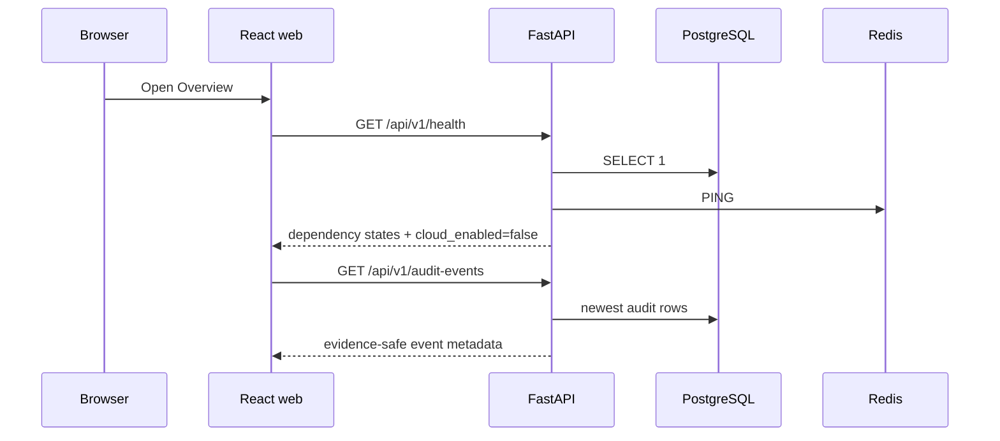
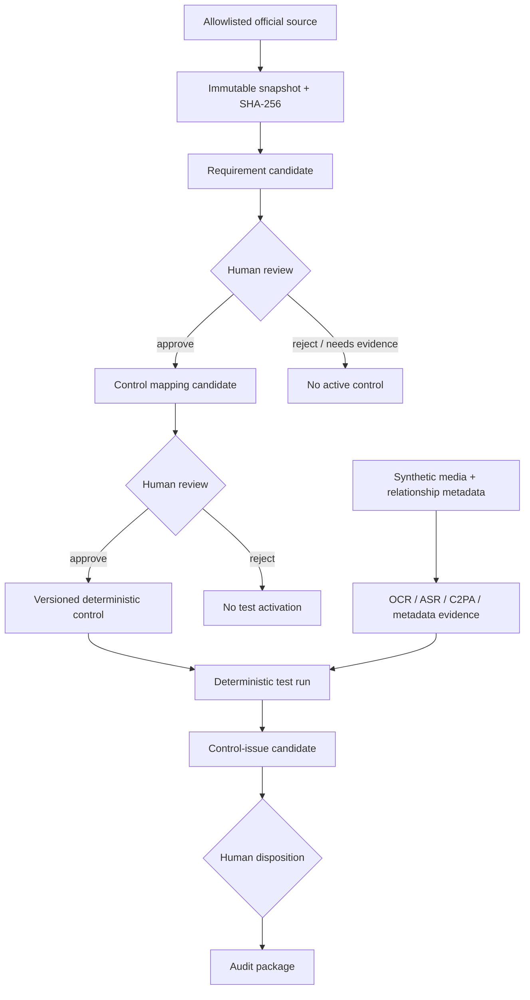

# Architecture

## Design rule

Make state, evidence, authorization, and failure observable before adding model autonomy.

The project is one orchestrated product with bounded tools, not a set of agents that can approve one another. Each tool has a narrow input/output contract. PostgreSQL records durable state and audit lineage; the queue only transports work.

## Service responsibilities

| Service | Owns | Must not own |
|---|---|---|
| `web` | review UI, evidence display, status visibility | business truth, approvals without API validation |
| `api` | schemas, authorization, human transitions, queries | long-running media or model work |
| `worker` | retryable fetch/extract/analyze/report jobs | human approval, external action |
| `postgres` | authoritative state, versions, reviews, audit events | queue delivery |
| `redis` | Celery broker and ephemeral results | business records or approval state |
| host Ollama | structured candidate generation | deterministic validation, approval, enforcement |

## Read request path

Liveness is deliberately separate from readiness. `/health/live` proves the API process responds; `/health` reports whether database and queue dependencies are reachable.

## Implemented full workflow

## Trust boundaries

1. Source pages, snapshots, captions, transcripts, media metadata, and model output are untrusted data.
2. Candidate creation and approval are different permissions and different events.
3. An exact quote is required before a requirement can be reviewed.
4. An approved requirement alone cannot run a test; it needs an approved mapping and versioned control.
5. A deterministic failed test creates a candidate finding, not a legal conclusion.
6. Report generation reads reviewed state; it cannot mutate a finding.
7. Export produces local artifacts only; external submission does not exist in v0.1.

## Correlation and lineage

Every workflow receives a `correlation_id`. Audit events carry:

- event type;
- entity type and stable entity ID;
- actor type and actor ID;
- correlation ID;
- structured payload;
- UTC timestamp.

Domain records preserve model, rule, source snapshot, mapping, evidence, and test-run versions. Redis task IDs are operational metadata, not lineage keys.

## Implemented slow paths

`media.analyze_case` confines the path to the project root; validates declared MIME, `.mp4`, ISO BMFF `ftyp`, size, and SHA-256; then enforces FFprobe duration, resolution, and video-frame limits before frame extraction, Tesseract, the selected ASR provider, or `c2pa-python` runs. Subprocesses also have time limits. The rule engine queries only mappings whose state is `approved` and confirms that the parent requirement is also `approved`.

`evaluation.run_gold` evaluates the fixed 50-case dataset. CI uses fixture transcripts; a real local run used Faster-Whisper. A worker restart is required when task registration code changes because Celery does not hot-reload task definitions.

### Worker delivery semantics

The media task is intentionally at-least-once. It uses Celery late acknowledgement, bounded automatic retry for `RuntimeError` (two retries with backoff), and requeue-on-worker-loss. The local worker reserves one job at a time and runs with concurrency one because OCR, ASR, and FFmpeg are resource-heavy. This follows Celery's requirement that late-acknowledged tasks be idempotent; it does not claim exactly-once queue delivery. See the official [Celery task acknowledgement guidance](https://docs.celeryq.dev/en/stable/userguide/tasks.html#acks-late) and [configuration reference](https://docs.celeryq.dev/en/stable/userguide/configuration.html#task-reject-on-worker-lost).

Idempotency lives in PostgreSQL, not Redis: evidence has a unique `(case_id, stable_key)` identity that includes the asset hash; test runs have a unique `(case_id, mapping_id, rule_version)` identity; and findings are unique per test run. A redelivery therefore reuses the same business records. Every successful execution audit event records the Celery task ID, retry count, and redelivery flag.

`evaluation.run_gold` deliberately remains early-acknowledged with no automatic retry. A run currently creates a new `EvaluationRun` identity before processing; silently retrying it would create a second run and blur benchmark provenance. A failed evaluation is rerun explicitly as a new evaluation until a future version introduces an idempotent evaluation-run key. Heartbeat is also not a late-acknowledged business mutation.

The local Ollama path passes a Pydantic-generated JSON schema in Ollama's `format` field and validates the returned JSON again before constructing a candidate. The deterministic layer checks exact-quote presence against the immutable snapshot, scans all interpretation fields for prohibited legal conclusions, and requires the model jurisdiction to equal source metadata. `scripts/verify_local_ollama.py` can run the same parser against a bounded current-snapshot passage without database persistence; CI never calls it.

The Requirements read path returns batched lineage: candidate, source metadata, immutable snapshot summary, authority gate, bounded quote-adjacent context, and review history. The context extractor tolerates whitespace changes, maps the normalized match back to original line positions, limits the excerpt to 6,000 characters, hashes it, and marks truncation. It sends plain untrusted text rather than the full runtime snapshot. Approval requires `current` or human-confirmed `manual_snapshot` evidence. The service writes the human review row before changing status; PostgreSQL then verifies both the evidence class and matching review, preventing fixture-backed approval or a direct status update that bypasses review.

See [ADR 0003](adr/0003-bounded-source-context-for-review.md) for the review-context tradeoff.

Mappings and findings use equivalent batched lineage paths. Mapping lineage joins
the candidate to its approved requirement, control definition, and review history.
Finding lineage joins the candidate to its deterministic test run, requirement,
control, linked evidence, and review history. The UI requires Song to write a
non-template rationale before any disposition; Pydantic and PostgreSQL migration
`0006` independently reject fewer than 20 trimmed characters.

The source refresh path performs credential-free HTTPS access against a host allowlist, rejects unsafe redirects, limits response size, extracts visible text, hashes the result, and stores an immutable snapshot. The eCFR adapter first resolves the official Title metadata date and then reads dated Part XML from the official Versioner API. The TikTok adapter reads only registry-fixed FAQ IDs from TikTok's public JSON endpoint and rejects status, ID, title, or marker drift. Both adapters preserve the canonical public URL and exact retrieval URL in locator metadata. Pages that cannot be safely fetched enter `manual_snapshot_required`.

## Local report path

The report service reads the current case asset hash, evidence, test runs, findings, reviews, mappings, controls, requirements, snapshots, and sources into one lineage manifest. It escapes untrusted content for HTML and writes HTML, PDF, JSON, and CSV under `.runtime/reports/`. No network client exists in this service.

## Failure semantics

Failures are explicit states:

- source access: `blocked`, `fetch_error`, `manual_snapshot_required`;
- extraction: `invalid_schema`, `quote_not_found`, `needs_more_evidence`;
- media: `unsupported_media`, `ocr_unavailable`, `asr_unavailable`, `provenance_unreadable`;
- workflow: `candidate`, `rejected`, `superseded`, `needs_more_evidence`;
- dependency health: `healthy` or `degraded` with per-service status.

No cached or partial result is promoted to current/approved merely because a retry failed.
